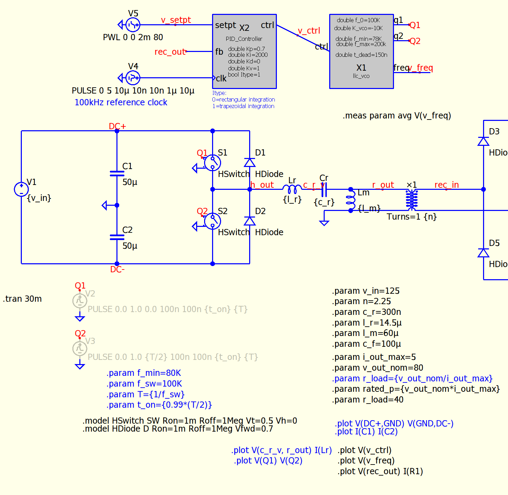
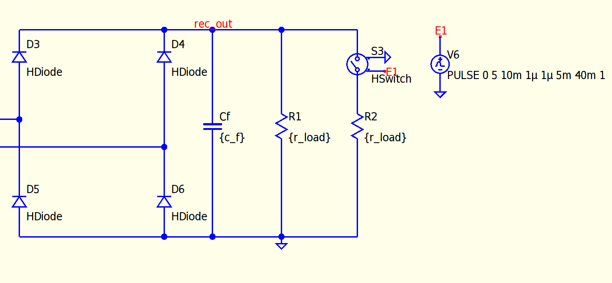
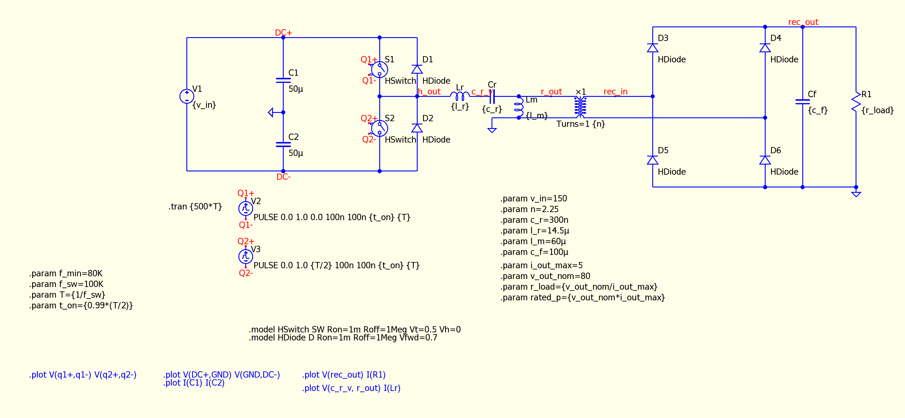
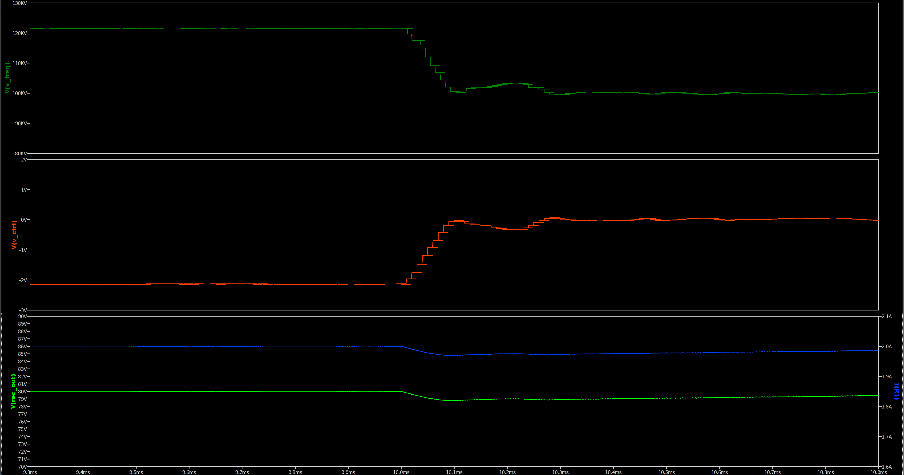

# Half-Bridge LLC Resonant Converter (QSPICE + Custom C++ Control)

Open-loop and closed-loop simulation of a digitally controlled half-bridge LLC resonant converter in **QSPICE**, using custom compiled C++ DLL (`Ø`-device) blocks for the adaptive digital PID controller and variable-frequency half-bridge VCO/gate driver.

## Reference Paper

Converter parameters and transient targets are based on:

> C. Buccella, C. Cecati, H. Latafat, and K. Razi, *"Comparative Transient Response Analysis of LLC Resonant Converter Controlled by Adaptive PID and Fuzzy Logic Controllers,"* IECON 2012 – 38th Annual Conference on IEEE Industrial Electronics Society, pp. 4729–4734, 2012.  
> **DOI:** [10.1109/IECON.2012.6389483](https://doi.org/10.1109/IECON.2012.6389483)

| Parameter | Symbol | Value |
| :--- | :---: | :--- |
| Input DC Voltage | $V_{\text{in}}$ | `100 V` nominal (`75–125 V` ±25% tested; paper range `50–150 V`) |
| Output DC Voltage | $V_{\text{out}}$ | `80 V` |
| Max Output Current | $I_{\text{out,max}}$ | `5 A` |
| Series Resonant Inductance | $L_r$ | `14.5 µH` |
| Series Resonant Capacitance | $C_r$ | `300 nF` ($f_{r1} \approx 76.3\text{ kHz}$) |
| Magnetizing Inductance | $L_m$ | `60 µH` ($f_{r2} \approx 33.7\text{ kHz}$) |
| Transformer Turns Ratio | $1:n$ | `1 : 2.25` |
| Output Filter Capacitance | $C_f$ | `100 µF` |
| Nominal / Stepped Load | $R_{\text{load}}$ | `40 Ω` (`2 A`) $\leftrightarrow$ `20 Ω` (`4 A`) |

---

## Repository Contents

| File | Description |
| :--- | :--- |
| [half-bridge.qsch](half-bridge.qsch) | Main closed-loop QSPICE schematic (open-loop sources `V2`/`V3` kept commented out) |
| [llc_vco.cpp](llc_vco.cpp), [llc_vco.qsym](llc_vco.qsym), [llc_vco.dll](llc_vco.dll) | Custom C++ half-bridge VCO with dead-time generation |
| [pid_controller.cpp](pid_controller.cpp), [pid_controller.qsym](pid_controller.qsym), [PID_Controller.dll](PID_Controller.dll) | Adaptive discrete PID controller (adapted from [robdunn4/QSpice](https://github.com/robdunn4/QSpice)) |

---

## Custom C++ Components

### 1. Half-Bridge VCO & Gate Driver ([llc_vco.cpp](llc_vco.cpp))
Models a shadow-loaded variable-frequency PWM timer (like the paper's TMS320F28069 DSP ePWM):
* **4-state cycle:** `DEAD_A -> TOP_ON -> DEAD_B -> BOTTOM_ON` (`0 V / 5 V` complementary gate drives `q1`, `q2` with `t_dead = 150 ns`).
* **Cycle-by-cycle frequency update:** Computes `f = clamp(K_vco * ctrl + f_0, f_min, f_max)` once per full cycle to guarantee 50% symmetry and prevent transformer flux imbalance.
* **LLC polarity & ZVS clamping:** Negative `K_vco = -10k` Hz/V (higher frequency $\rightarrow$ lower gain) and `f_min = 78 kHz` (`f_max = 200 kHz`) to stay on the inductive/ZVS side of the resonant peak (`~74 kHz` at `20 Ω`).
* **Edge precision:** Uses `Trunc()` (`ttol = 1 ns`) so SPICE lands cleanly on switching edges.

### 2. Adaptive Digital PID Controller ([pid_controller.cpp](pid_controller.cpp))
Adapted from [robdunn4/QSpice](https://github.com/robdunn4/QSpice) (clocked at `100 kHz`, trapezoidal integration `Itype = 1`):
* **Clamping & anti-windup:** Clamps `ctrl` to `[u_min, u_max]` (`[-10.0, 4.5]`) and freezes integration when saturated.
* **Filtered derivative-on-measurement:** Low-pass filtered (`Tf = 100 µs`) on `-fb` to avoid startup derivative kick and reject switching ripple.
* **Adaptive transient boost:** Smoothly boosts `Kp` from `1×` in steady state up to `2.5×` during large transients (mirroring Section III.B of the paper).
* **Tuned settings:** `Kp = 0.5–0.7`, `Ki = 2000`, `Kd = 0`, `Kv = 1`, `Itype = 1`, with soft-start setpoint `PWL(0 0 2m 80)`.

---

## Schematics & Results

### Closed-Loop Schematic
| Control Loop, Half-Bridge & Resonant Tank | Rectifier, Output Filter & Switched Load Step |
| :---: | :---: |
|  |  |

### Open-Loop
| Open-Loop Half-Bridge LLC |
| :---: | 
|  |

### Closed-Loop Load-Step Transient (`40 Ω -> 20 Ω`)
Regulates `80.0 V` across `75–125 V` (±25%) input variation. On the `2 A -> 4 A` load step, the adaptive PID holds the dip to **`~1.2 V` (`1.5%`)** with clean discrete `v_freq` steps and no ringing (matching Fig. 6 of the paper: `1.25 V` / `1.56%`):



---

## Quick Reference: Creating & Compiling C++ Blocks in QSPICE

QSPICE natively compiles C++ blocks (**Ø-devices**) using its bundled **Digital Mars C++ compiler (`dmc.exe`)** — works on Windows and on Linux under Wine/Bottles.

1. **Create the symbol:**
   * **Schematic → Draw → Hierarchical Block** → Right-click → **Symbol Properties** → set **Symbol Type** to **`Ø`** (DLL).
   * Add input/output ports (`double`, `bool`, etc.) and any instance attributes (`double Kp=0.5`, etc.).
2. **Generate the template:**
   * Right-click block → **C++ Interface → Create C++ Template** to auto-generate `<name>.cpp` with the `union uData *data` mapping, `DllMain`, `MaxExtStepSize`, `Trunc`, and `Destroy`.
3. **Key rules when writing the C++:**
   * Store per-instance state inside `struct s<NAME> *inst = *opaque;` (never globals/statics); free it in `Destroy`.
   * Read inputs/attributes by value (`data[i].d` / `.b`); write outputs via references (`double &out = data[i].d;`).
   * Implement `MaxExtStepSize` and/or `Trunc` whenever your block creates time-based edges.
   * Keep `.qsch`, `.qsym`, `.cpp`, and `.dll` in the **same directory** (avoid spaces in paths under Wine/Bottles).
4. **Compile & reuse:**
   * Press **Run (`F5`)** and click **Yes** when prompted to compile (or open the `.cpp` in QSPICE, right-click inside the editor → **Compile**).
   * Manual 32-bit DLL build command:
     ```cmd
     dmc -mn -WD -o llc_vco.cpp kernel32.lib
     ```
   * Reuse a block in another schematic by copy-pasting (`Ctrl+C` / `Ctrl+V`) or saving it as a `.qsym` alongside its `.cpp`/`.dll`.

---

## Quick Notes for Picking This Back Up
* **Line-step testing:** Replace `V1`'s `{v_in}` with `PULSE(100 140 10m 10u 10u 4m 100m)` (paper Fig. 7) or a `PWL(...)` ramp for `75–125 V`, and set `V6` to `0 V` to isolate input regulation.
* **Matching `u_max` to `f_min`:** In [pid_controller.cpp](pid_controller.cpp), `f_min = f_0 + K_vco * u_max` (e.g., `u_max = 2.2` matches `f_min = 78 kHz`).
